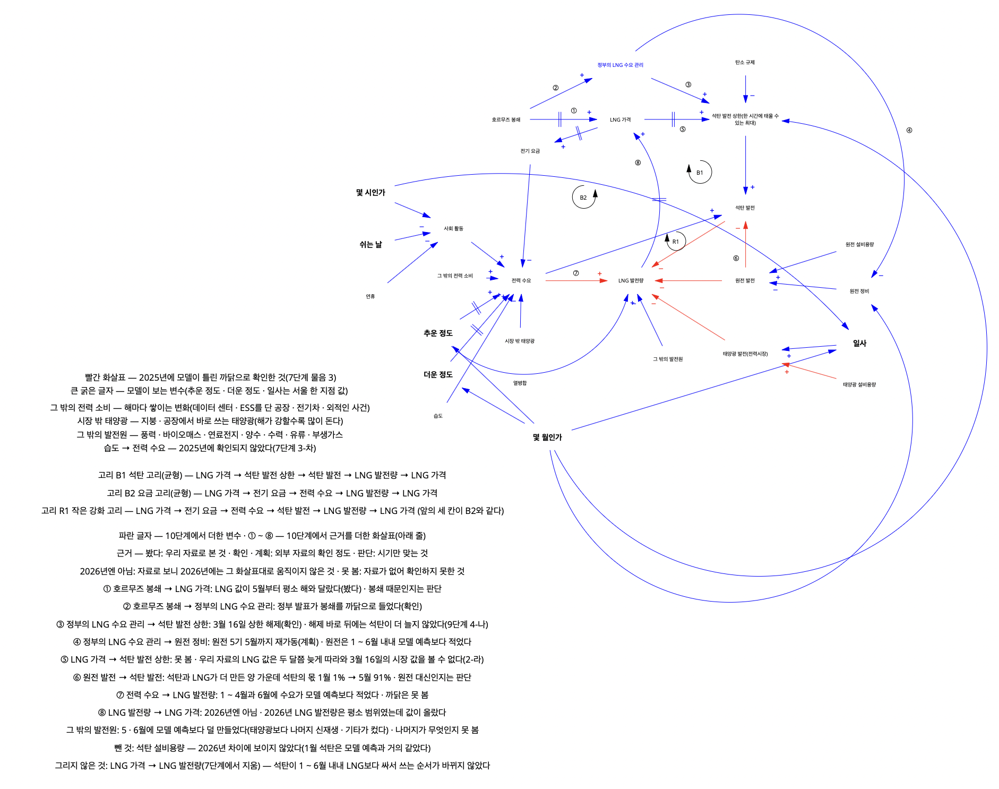
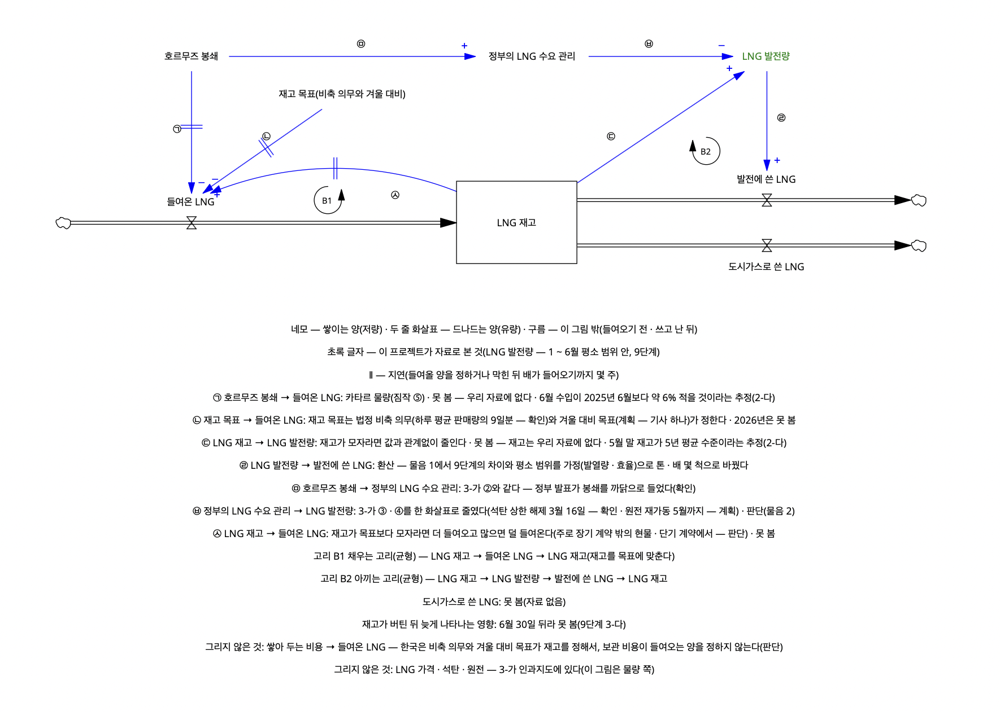

# 시간별 LNG 발전량 — 평소 패턴을 배운 모델로 2026년이 평소와 얼마나 달랐는지 확인한다

[발표 자료(PDF, 20장)](발표자료.pdf)

## 한눈에 보기

**물음** — 2026년 1 ~ 6월(호르무즈 사태가 있던 때) 우리나라 LNG 발전량은, 날씨 · 시각 · 날 종류가 같을 때의 평소 패턴과 얼마나 달랐나.

**한 일** — 전력거래소의 시간별 발전량과 기상청 서울 날씨(2023 ~ 2026년, 시간별 약 3만 행)로, 몇 시인가 · 무슨 날인가 · 기온 · 햇빛 · 몇 월인가를 보고 LNG 발전량을 예측하는 모델을 만들었다. 2023 · 2024년으로 배운 모델 넷을 2025년으로 채점해 그래디언트 부스팅을 골랐고(결정계수 0.7553, 날씨를 모르는 기준선보다 나았다), 2023 ~ 2025년으로 다시 배워 2026년 1 ~ 6월을 예측해 실제와 비교했다.

**결과**
- 2023 ~ 2025년으로 배운 모델의 2026년 1 ~ 6월 예측은 결정계수 0.77이었다(LNG 발전량이 늘고 주는 것의 77%를 설명). 실제는 모델 예측과 달마다 약 −11% ~ +7% 달랐다.
- 2026년 1 ~ 6월 LNG 발전량은 달마다 모두 평소 범위 안이었다. 평소 범위는 모델이 2024 · 2025년을 예측했을 때 한 달 평균으로 가장 크게 틀린 크기(한 시각 ±2,177 MWh — 발전에 쓴 LNG를 배로 바꾸면 30일에 약 3 ~ 4척)다. 날로 나눠 봐도, 낮과 밤으로 나눠 봐도 2024 · 2025년에 가장 크게 틀린 날 · 달보다 크게 틀린 곳은 없었다. 그래서 평소 패턴과 달랐다고 말할 근거가 없다(같았다는 뜻은 아니다).
- 그 안에서 LNG 발전량은 1 ~ 3월에 모델 예측보다 많았고 6월에는 적었다. 원전 발전량은 1 ~ 6월 내내 모델 예측보다 적었고(LNG를 늘리는 쪽), 석탄 발전량은 2월부터 많았고 전력 수요는 5월을 뺀 달에 적었다(줄이는 쪽). 이 둘이 같은 달에 상쇄되어 LNG의 차이가 작게 나왔다. 석탄과 LNG의 발전량이 각각 모델 예측보다 많았던 양을 합친 것 가운데 석탄의 비율은 1월 1%에서 5월 91%로 커졌다.
- 석탄 발전량이 많았던 까닭은 찾지 못했다. LNG와 석탄의 연료비단가 차이로는 설명되지 않고, 시기가 맞는 후보(계절관리제와 3월 16일 상한 해제 · 연료비단가 차이 · 정부의 LNG 수요 관리)는 셋이지만 이 자료로는 구별할 수 없다. 석탄이 많아지기 시작한 때(1월 하순)는 호르무즈 사태(2월 28일)보다 앞이었다.
- LNG 발전량을 크게 움직인 순서는 몇 시인가 → 무슨 날인가 → 기온 → 햇빛 → 몇 월인가였다.

**한계** — 자료로 가진 것은 LNG 발전량뿐이라, 들여온 LNG와 재고를 보지 못해 2026년에 LNG가 모자랐는지는 말할 수 없다. 평소 범위는 한 달 LNG 발전량의 10 ~ 15%보다 작은 변화는 잡지 못한다.

## 언제 무엇을 했나 (2026년 9 ~ 10월)

| 기간 | 한 일 |
|---|---|
| 09-02 ~ 09-12 | 처음 세운 설계(LNG 장기계약과 스팟 가운데 어느 쪽이 유리했나)는 맞춰 볼 정답이 데이터에 없어 그만두고, 지금의 물음으로 바꿨다 |
| 09-12 ~ 09-22 | 1 ~ 4단계 — 물음을 정하고, 시간별 발전량과 날씨 자료를 받아 비어 있거나 잘못 들어 있는 기간을 확인하고, 무엇이 LNG 발전량을 늘리거나 줄이는지 살펴봤다 |
| 09-24 ~ 10-05 | 5 · 6단계 — 모델에 넣을 열(기온 · 날 종류 · 일사 같은 것)을 만들고, 어느 해로 배우고 채점할지와 시험할 모델 넷을 정했다 |
| 10-05 ~ 10-17 | 7 · 8단계 — 모델 넷을 2025년으로 한 번 채점해 넷 다 기준선보다 잘 맞힌 것을 확인하고, 그래디언트 부스팅 하나로 정했다 |
| 10-17 ~ 10-29 | 9 · 10단계 — 2026년 1 ~ 6월의 LNG 발전량을 예측해 실제와 비교하고, 석탄 발전량이 많았던 까닭을 찾아봤다 |
| 10-29 ~ 10-30 | 11단계 — 결론과 한계를 정리하고 이 README를 썼다 |

## 전체 흐름 — 단계마다 한 일과 정한 것

| 단계 (끝낸 날) | 한 일과 정한 것 | 자세히 보는 칸 |
|---|---|---|
| 1 과제 정의 (09-18) | 답할 물음을 「2026년 LNG 발전량은 평소 패턴에서 얼마나 벗어났는가」로 정하고, 그 차이의 주요 원인을 살펴보는 것까지 물음에 넣었다. 예측 대상은 전력시장에서 거래된 시간별 LNG 발전량(MWh)이다. LNG 발전량을 늘리거나 줄일 것 같은 원인을 짐작으로 여섯 줄 적었다. | 문제 |
| 2 데이터 수집과 구성 보기 (09-19) | 전력거래소(시간별 발전량) · 기상청(서울의 시간별 기온 · 습도 · 일사) · 전력통계정보시스템(EPSIS, 월별 발전량) · 공휴일 자료를 받아, 몇 줄 몇 칸인지와 빠지거나 겹친 시각이 있는지 봤다. 2023 ~ 2025년 LNG 발전량의 월 합계는 값이 잘못된 기간이 든 달을 빼면 EPSIS와 맞았다. | 데이터 |
| 3 정제 (09-19) | 전력거래소에서 받은 시간별 발전량 가운데 세 기간(2024년 2월 29일 · 2024년 8월 · 2026년 5월 2 ~ 17일)은 값이 비어 있거나 잘못 들어 있었다. 실제 발전이 그랬던 것이 아니라 받은 자료가 잘못된 것이어서, 이 기간은 모델이 배우는 데에도 2026년과 비교하는 데에도 쓰지 않았다. 2023년에 이상치로 나온 22시각은 값이 잘못된 것이 아니라 조건이 극단적이었던 시각이라 남겼다. | 데이터 |
| 4 탐색적 분석 (09-22) | 무엇이 LNG 발전량을 늘리거나 줄이는지 그림과 상관분석(두 값이 함께 늘고 주는 정도를 −1 ~ 1의 상관계수로 나타내는 것)으로 봤다. LNG 발전량과 상관계수가 가장 큰 것은 몇 시인가와 주말인가였다. 기온은 18 ~ 20도쯤에서 LNG 발전량이 가장 적고, 그보다 춥거나 더울수록 늘었다. 낮에는 태양광 발전량이 많을수록 LNG 발전량이 줄었다. 석탄 발전량은 LNG 발전량보다 먼저 바뀌지 않고 같은 시각에 함께 정해져서, 입력에 넣지 않기로 한 것을 그대로 두었다. | 방법 |
| 5 변환 · 파생변수 (09-30) | 4단계에서 남긴 입력 후보(몇 시인가 · 요일 · 공휴일 · 기온 · 태양광 같은 것)를 모델에 넣을 열로 만들었다. 기온은 그대로 넣는 열과 함께, 16도보다 몇 도 추운지와 24도보다 몇 도 더운지를 나타내는 열(선형회귀에 넣을 열)을 만들었다. 공휴일과 명절은 요일과 함께 날 종류(화 ~ 금 · 토 · 일 · 공휴일 · 명절)로 넣었다. 태양광은 2026년 자료에 발전량이 따로 없어서 일사(햇빛 세기)를 넣어 봤다. 2023년으로 배워 2024년을 맞힐 때 일사를 넣은 쪽이 태양광 발전량을 넣은 쪽보다 더 잘 맞혀서, 일사로 정했다. | 방법 |
| 6 분석계획 (10-05) | 원전 발전량은 넣어 보니 「원전 발전량이 줄면 LNG 발전량도 준다」로 배웠다. 원전이 덜 발전하면 LNG 같은 다른 발전원이 더 발전해야 하므로, 그 반대로 배운 것이다(2024년에 석탄이 줄면서 원전과 LNG가 같이 늘어서 생긴 일이다). 2024년도 더 못 맞혀서 입력에서 뺐다. 습도는 넣어도 2024년을 맞히는 정도가 거의 그대로여서 뺐다. 그다음 2023 · 2024년으로 배워 2025년에 한 번 채점하고, 2026년 1 ~ 6월과 비교하기로 했다. 모델이 이것보다 잘 맞혀야 쓸 이유가 있는 기준선(배운 해에서 같은 달 · 같은 시각 · 같은 날 종류인 시각들의 평균)과 시험할 모델 넷을 정했다. 모델이 보는 것과 보지 못하는 것은 인과지도로 그렸다. | 방법 · 결과(인과지도) |
| 7 모델링과 검정 (10-09) | 2025년으로 한 번 채점해, 모델 넷 모두 기준선보다 잘 맞힌 것을 확인했다. 낮에는 LNG 발전량을 실제보다 많게 예측했고(태양광 설비가 늘어서), 30도 넘는 시각과 토요일에 크게 틀렸다. 달마다 모델이 LNG를 더 많게 또는 더 적게 예측한 것은 12달 가운데 10달이 원전 · 석탄 발전량이 모델 예측과 달랐던 것과 같은 쪽이었다. 채점을 본 뒤 모델을 고치면 그 점수가 실제보다 좋게 나와서, 모델은 고치지 않고 틀린 곳을 한계로 적었다. | 방법 · 한계 |
| 8 모델 확정과 핵심인자 (10-17) | 결과를 보기 전에 정한 고르는 방법 둘(두 해(2024 · 2025년) 모두 더 잘 맞히고 나눠 봐도 꾸준히 나은 모델 · 2025년 결정계수가 가장 높은 모델)이 모두 그래디언트 부스팅을 골랐다. 모델에 넣은 다섯이 모두 LNG 발전량을 움직였고, 2023 · 2024년 자료에서 몇 시인가 → 무슨 날인가 → 기온 → 햇빛 → 몇 월인가 순서로 크게 움직였다. 1단계 짐작 여섯 줄과 맞춰 보니 맞은 것은 추위 하나였다. | 방법 · 결과(처음 짐작과 데이터) |
| 9 모델 적용 (10-27) | 그래디언트 부스팅을 2023 ~ 2025년으로 다시 배워 2026년 1 ~ 6월의 LNG 발전량을 예측하고 실제와 비교했다. 차이는 달마다 평소 범위(2024 · 2025년에 모델 예측이 한 달 평균으로 가장 크게 틀린 크기 — 2026년 LNG를 보기 전에 정한 기준) 안이라, 평소 패턴과 달랐다고 말할 근거가 없었다. 그 안에서 원전 발전량이 1월부터 모델 예측보다 적었던 것과 석탄 발전량이 평일에 많았던 것이 상쇄됐다. | 결과 |
| 10 결과 해석 (10-29) | 9단계의 차이를 LNG 배 몇 척으로 바꿔 봐도 달마다 평소 범위 안이라는 판정은 같았다. 석탄 발전량이 많았던 까닭을 찾아봤지만, LNG와 석탄의 연료비단가 차이로는 설명되지 않았고 까닭은 찾지 못했다. 이 프로젝트가 자료로 가진 것(LNG 발전량)과 가지지 못한 것(들여온 LNG · 재고 같은 것)을 인과지도와 저량 · 유량 그림으로 그렸다. | 결과 · 한계 |
| 11 결론 (10-30) | 1단계 물음에 대한 답을 적고, 앞 단계에서 넘어온 한계를 모으고, 처음 보는 사람이 읽을 수 있게 이 README를 다시 썼다. 2026년 1 ~ 6월 예측이 실제와 몇 % 달랐는지도 이때 처음 %로 냈다(결정계수 0.77, 달마다 약 −11% ~ +7%). | 결과 · 한계 |

**단계를 오간 것**

- 09-02에 처음 세운 설계(LNG 장기계약과 스팟 가운데 어느 쪽이 유리했나)는 맞춰 볼 정답이 데이터에 없고 두 가격의 뺄셈이라 09-12에 그만두고, 지금의 물음으로 1단계를 다시 정했다.
- 4단계를 3단계보다 먼저 했다(09-13). 4단계의 상자그림에서 이상치 22시각이 나와 3단계의 물음이 됐다.
- 09-17에 단계를 지금의 11단계로 다시 나누고, 1단계부터 다시 봤다.
- 10-13에 8단계를 하다 멈추고, 1단계부터 무엇을 왜 했는지 다시 확인했다.
- 10-27에 9단계를 하다 2단계로 돌아가 원전마다의 시간별 자료를 받으려 했지만, 한수원 API가 날짜와 상관없이 가장 최근 엿새만 줘서 쓰지 못했다.
- 10-28에 10단계 물음 2(석탄 발전량이 많았던 까닭)를 끝냈다가, 석탄의 비율을 낼 때 전력 수요가 적었던 것을 넣지 않은 것을 찾아 다시 열었다.

## 문제

**왜** — 수치적인 데이터로 살펴보는 게 목적이다. 느낌이 아니라. *(2026-09-18에 내가 쓴 문장)*

**물음** — 2026년 LNG 발전량은 평소 패턴에서 얼마나 벗어났는가. 그 차이의 주요 원인은 무엇인가.

- 평소 패턴 — 평소 해(2023 ~ 2025년)에 날씨 · 시각 · 날 종류에 따라 LNG 발전량이 나온 패턴이다. 이 패턴을 배운 모델이 2026년의 날씨 · 시각 · 날 종류를 보고 예측한 양을 「모델 예측」이라고 부른다.
- 벗어났는가 — 2026년 실제 LNG 발전량이 모델 예측과 얼마나 달랐는가다. 날씨 · 시각 · 날 종류가 같을 때 평소 패턴과 비교한 차이다.

**예측 대상(종속변수 y)** — 전력시장에서 거래된 시간별 LNG 발전량(MWh). 모델은 한 시각마다 LNG 발전량을 예측한다. 이것을 고른 것은, 모델의 예측과 비교해 볼 실제 값이 전력거래소 자료에 시간마다 기록돼 있어서다(처음 세운 설계는 비교해 볼 실제 값이 데이터에 없어서 그만뒀다 — 전체 흐름의 「단계를 오간 것」).

**하지 않은 것**

- 가격은 예측하지 않고 입력에도 넣지 않았다. 2026년에 달라진 것이 가격이라, 넣으면 평소와 얼마나 달랐는지가 0에 가까워진다.
- 원전 · 석탄 발전량과 총 전력거래량도 입력에 넣지 않았다. 총 전력거래량을 넣으면 「LNG = 총 전력거래량 − 나머지 발전량」이라는 뺄셈이 되어 모델이 필요 없어진다. 석탄은 LNG와 같은 시각에 함께 정해지고, 2026년에 달라진 것 자체다. 원전은 넣으면 반대로 배웠다(전체 흐름 6단계). 이 셋은 결과를 해석할 때 차이 옆에 놓았다.
- 예측 대상은 전국 발전용 LNG이고, 특정 회사가 사들이는 LNG의 양이 아니다.

## 데이터

**받은 자료**

| 자료 | 어디서 받았나 | 기간 | 어디에 썼나 |
|---|---|---|---|
| 연료마다의 시간별 발전량 | 전력거래소 — 2023 · 2025년은 공공데이터포털의 연간 파일, 2024 · 2026년은 공공데이터포털 API(2024년 연간 파일에는 LNG가 없다) | 2023년 1월 ~ 2026년 8월 22일 | LNG 발전량은 예측 대상. 원전 · 석탄 · 태양광 같은 다른 발전원은 결과를 해석할 때 |
| 서울의 시간별 날씨 | 기상청 종관기상관측(ASOS) 서울(108) — 공공데이터포털 API | 2023년 1월 ~ 2026년 8월 | 기온 · 일사는 모델 입력(습도는 넣어 보고 뺐다) |
| 연료마다의 월별 발전량 | 전력통계정보시스템(EPSIS) | 2002년 1월 ~ 2026년 7월 | 받은 시간별 발전량의 월 합계가 맞는지 확인 · 해마다 LNG가 차지한 비율 |
| 공휴일 | `holidays` 패키지로 만든 표 | 2023 ~ 2026년 | 모델 입력(날 종류) |
| 연료마다의 연료비단가 | EPSIS 「연료비용」 | 2023년 1월 ~ 2026년 9월 | 석탄 발전량이 많았던 까닭을 찾을 때(10단계) |

**받지 않은 해** — 2020 ~ 2022년은 받지 않았다. 2020년은 코로나로 전력거래량이 줄었고, 2021년은 LNG 발전량이, 2022년은 원전 발전량이 크게 늘어서 평소 해로 삼기 어려웠다(EPSIS로 확인). 그래서 모델이 배운 해는 두세 해뿐이다(「한계」).

**뺀 기간과 그 까닭(3단계)**

- 2024년 2월 29일 — API에 그날 자료가 없었다.
- 2024년 8월 — API가 연료 다섯 가지만 주고, LNG 값이 다른 날의 49분의 1쯤이었다. 모델이 배우는 데서 뺐다. 그래서 8월은 다른 달보다 적은 해로 배웠다.
- 2026년 5월 2 ~ 17일 — LNG가 빠져 있거나 값이 잘못 들어 있었다. 2026년과 비교하는 데서 뺐다(5월은 1일과 18 ~ 31일만 비교했다).
- 2024년 8월과 2026년 5월은 같은 날짜를 다시 요청해도 같은 값이 왔고, EPSIS 월 합계에는 정상으로 들어 있었다. 실제 발전이 아니라 받은 자료의 문제다.
- 2026년 7 · 8월 — 받은 7월 값이 EPSIS 월 합계와 0.99% 어긋나고(평소 해에 가장 크게 어긋난 달은 0.24%), 8월은 EPSIS에 아직 없어 확인할 수 없어서 비교에 넣지 않았다(9단계).
- 남긴 것 — 2023년 상자그림에서 이상치로 나온 22시각은 대부분 한겨울 평일 아침이나 3월 일요일 한낮이었다. 값이 잘못 들어온 것이 아니라 조건이 극단적이었던 시각이라 남겼고, 빼도 기온과 LNG 발전량의 상관계수가 거의 그대로였다.

## 방법

**모델에 넣은 것** — 그래디언트 부스팅에 일곱 열을 넣었다.

- 몇 시인가(0 ~ 23시) · 몇 월인가
- 무슨 날인가 — 요일 · 공휴일인가 · 명절인가
- 기온 · 일사(햇빛 세기) — 둘 다 서울 한 지점의 시간별 값

선형회귀는 직선 하나로만 배워서 같은 정보를 조건마다 열로 나눠 넣었다(67열). 시간대 · 월 · 날 종류는 0/1 열로, 기온은 16도보다 추운 만큼 · 24도보다 더운 만큼과 3시간 동안 바뀐 만큼으로 나누고, 쉬는 날에는 시간대마다 따로 배우게 했다(5단계).

**넣지 않은 것과 까닭**

- 원전 발전량 — 넣으면 「원전 발전량이 줄면 LNG 발전량도 준다」로 반대로 배웠다(6단계).
- 석탄 발전량 · 총 전력거래량 · 가격 — 「문제」의 「하지 않은 것」에 적었다.
- 태양광 — 발전량은 2026년 자료에 따로 없고, 설비용량은 2025년 값이 모두 배운 해의 범위 밖이라 일사로 대신했다(3 · 5단계).
- 습도 · 불쾌지수 — 넣어도 2024년을 맞히는 정도가 아래 기준만큼 나아지지 않았다(6단계).
- 풍력 · 바이오매스 · 연료전지 — 시간마다 오르내리는 폭이 LNG 발전량의 5% 안팎이거나 거의 일정해서 후보에서 뺐다(4단계).

**배우고, 채점하고, 비교한 해** — 해를 시간 순서대로 나눴다(앞의 해로 배우고 뒤의 해를 맞혔다).

- 넣을 열을 고르는 동안(5 · 6단계)은 2023년으로 배워 2024년을 맞혀 봤다. 이때 2025 · 2026년 LNG 발전량은 쓰지 않았다. 답을 미리 보고 고르면 채점이 처음 보는 해의 점수가 아니게 되기 때문이다(그 전에 본 것은 「한계」에 적었다).
- 고른 열로 2023 · 2024년을 배워 2025년에 한 번 채점했다. 채점을 본 뒤에는 모델을 고치지 않았다.
- 같은 모델을 2023 ~ 2025년으로 다시 배워 2026년 1 ~ 6월을 예측하고 실제와 비교했다.

**기준선과 모델 넷** — 기준선은 배운 해에서 같은 달 · 같은 시각 · 같은 날 종류인 시각들의 평균을 그대로 예측으로 쓰는 것이다. 모델은 이것보다 잘 맞혀야 쓸 이유가 있다. 모델은 넷(선형회귀 · 기온 × 시간대 선형회귀 · 랜덤포레스트 · 그래디언트 부스팅)을 시험했고, 2025년 채점에서 넷 모두 기준선보다 결정계수가 높았다(기준선 0.668, 모델 0.701 ~ 0.755). 결정계수는 우리가 고른 변수와 모델로 만든 예측이 LNG 발전량이 늘고 주는 것의 몇 %를 설명하는지 나타내는 값이다. 나머지는 모델이 설명하지 못한 부분으로, 넣지 않은 변수나 우연 때문이다. 1에 가까울수록 잘 맞힌 것이다. 고른 모델은 그래디언트 부스팅이다(아래 표의 8단계 줄).

**결정에 쓴 기준** — 단계마다 「무엇과 비교해서, 얼마나 나아야(달라야) 의미가 있다고 할까」를 결과를 보기 전에 적어 두고 그대로 정했다.

| 언제 | 무엇을 정하려고 | 기준(결과를 보기 전에 적은 것) | 그래서 |
|---|---|---|---|
| 5 · 6단계 | 이 열을 넣을까 | 2023년으로 배워 2024년을 맞혔을 때 결정계수가 0.002 넘게 오르나(기온을 나누는 기준 온도만 바꿔도 이만큼은 달라져서 정한 크기) · 배운 방향이 4단계에서 본 것과 반대가 아닌가 | 원전 · 습도 같은 열을 뺐다 |
| 6 · 7단계 | 모델을 쓸 이유가 있나 | 기준선보다 결정계수가 높은가 — 6단계는 2024년, 7단계는 2025년으로 한 번 | 모델 넷 모두 기준선보다 나았다 |
| 8단계 | 넷 가운데 어느 모델로 갈까 | 같은 달이 두 해(2024 · 2025년) 모두 기준선보다 더 틀리지 않았나 · 반대로 배운 것이 없나 · 두 해 모두 더 잘 맞히고, 달 · 시간대 · 기온 · 날 종류로 나눈 63묶음의 절반 넘게 덜 틀리나(2025년 결정계수가 가장 높은 모델도 나란히 봤다) | 그래디언트 부스팅 — 두 방법이 같은 모델을 골랐다 |
| 8단계 | 어느 변수가 크게 작용했나 | 그 변수를 같은 크기만큼 바꿨을 때 LNG 발전량 예측이 가장 크게 바뀌는가 | 결론의 순서(몇 시인가 → 무슨 날인가 → 기온 → 햇빛 → 몇 월인가)는 결과를 본 뒤 변수의 값을 뒤섞어 보는 방법으로 골랐다(「한계」) |
| 9단계 | 2026년이 평소와 달랐나 | 1 ~ 6월 가운데 「실제 − 모델 예측」의 한 달 평균 크기가 평소 범위(2024 · 2025년에 모델 예측이 한 달 평균으로 가장 크게 틀린 크기, 한 시각 2,177 MWh)를 넘는 달이 두 달 이상인가 | 넘은 달이 없어서, 달랐다고 말할 근거가 없다 |

## 결과

**결과를 읽는 법**

| 말 | 뜻 |
|---|---|
| 실제 | 그해(주로 2026년)에 실제로 발전한 양. 전력거래소 자료 그대로다 |
| 모델 예측 | 2023 ~ 2025년을 배운 모델이 그때의 날씨 · 시각 · 날 종류를 보고 예측한 양 |
| 실제 − 모델 예측 | 발전량 표의 숫자. + 면 실제가 모델 예측보다 많았고, − 면 적었다 |
| 평소 해 | 2023 · 2024 · 2025년. 「평소」는 이 세 해만 가리킨다 |
| 평소 범위 | 평소 해에 모델 예측이 한 달 평균으로 가장 크게 틀린 크기(한 시각 ±2,177 MWh). 모델이 예측해 본 2024 · 2025년으로 냈다 |
| 세 해 평균 | 2023 ~ 2025년 같은 달 값의 평균. 모델 없이 계산한 것으로, 연료비단가를 비교할 때만 쓴다 |

- 달마다의 차이는 그 달 모든 시각의 「실제 − 모델 예측」을 평균 낸 것이다. 예를 들어 1월의 차이는 1월 744시각마다 실제 − 모델 예측을 구해 평균 낸 값이다. 그 크기(+ · −를 뗀 값)가 평소 범위보다 크면 그달은 평소 범위 밖이다.
- 평소 범위 안이면 「달랐다고 말할 근거가 없다」로 읽는다. 「같았다」는 뜻이 아니다. 이 기준은 한 달 LNG 발전량의 10 ~ 15%보다 작은 변화는 잡지 못한다.
- 모델 밖의 일(호르무즈 사태 · 가격 · 석탄 발전 상한 해제 · 원전 발전량이 줄어든 것)이 차이의 얼마를 만들었는지는 구하지 않았다. 같은 달 원전 · 석탄 · 전력 수요가 모델 예측과 얼마나 달랐는지를 LNG의 차이 옆에 놓고 읽었다.
- 발전량이 달라진 때와 같은 때에 일어난 일(정책이나 사건)은 까닭의 「후보」로만 적었다. 같은 때에 일어났다고 그 일 때문이라고 할 수는 없고, 후보가 여럿이면 이 자료로는 무엇 때문인지 구별할 수 없었다.
- 괄호 안의 표시 — 「확인」은 일어난 뒤에 쓴 기사 둘 이상이나 정부 발표 원문이 있는 것, 「계획」은 하겠다는 발표만 있는 것, 「판단」은 자료로 확인하지 않고 해석한 것이다.

**모델과 2026년 예측** — 그래디언트 부스팅(입력 일곱 — 몇 시인가 · 몇 월인가 · 요일 · 공휴일 · 명절 · 기온 · 일사)을 2023 ~ 2025년 시간별 자료로 배워 2026년 1 ~ 6월을 예측했다. 결정계수는 0.77이다 — 우리가 고른 변수와 모델로 만든 예측이 LNG 발전량이 늘고 주는 것의 77%를 설명하고, 나머지 23%는 모델이 설명하지 못한 부분으로 넣지 않은 변수나 우연 때문이다. 실제는 모델 예측과 달마다 약 −11% ~ +7% 달랐다(아래 「2026년은 몇 % 달랐나」). 이 모델은 같은 방법으로 2023 · 2024년을 배워 처음 보는 2025년에 한 번 채점해 고른 것이다 — 2025년 결정계수 0.755, 한 시각에 틀린 크기 평균 14.6%, 한 달 평균으로 틀린 크기 평균 6.4%(7 · 8단계 · 11단계 3-카).

**2026년은 몇 % 달랐나** — 같은 모델을 2023 ~ 2025년으로 다시 배워 2026년 1 ~ 6월을 예측했다. 실제 − 모델 예측은 1 ~ 3월에 +4.8 ~ +7.0%(실제가 많았다), 4 · 5월에 +1.5 · +0.2%, 6월에 −10.6%(실제가 적었다)였다. 1 ~ 6월 전체로는 한 시각에 평균 13.0%, 한 달 평균으로 평균 5.0% 달라, 평소 해에 모델이 틀리던 크기와 비슷했다. 예를 들어 1월은 모델이 한 시각 평균 21,613 MWh로 예측했고 실제는 22,710 MWh였다(1월 744시각의 평균 — 한 달 합계는 약 1,690만 MWh). 한 달 합계로는 LNG 발전량이 약 1,100만 ~ 1,700만 MWh(5월은 15일만 비교해 약 580만 MWh)였고, 모델 예측과의 차이는 약 −115만(6월) ~ +97만(2월) MWh였다. 시각 하나하나로 보면 거의 딱 맞은 시각부터 크게 빗나간 시각까지 있었다. 시각의 절반은 차이가 약 11% 안, 약 80%는 ±20% 안이었다. 차이를 그 시각 실제의 몇 %인지로 보면, 가장 크게 빗나간 시각은 설날 당일(2월 17일) 오후 2시로 실제(5,559 MWh)가 모델 예측(약 1만 2,100 MWh)의 절반도 안 됐고, 실제가 모델 예측보다 가장 많았던 시각은 2월 22일(일) 오전 7시였다(실제 18,090 MWh · 모델 예측 약 1만 300 MWh). 차이를 양(MWh)으로 보면 가장 크게 빗나간 시각은 2월 24일(화) 오후 1시였다(실제 38,006 MWh · 모델 예측 약 2만 6,000 MWh). 달마다의 차이는 모두 평소 범위(평소 해에 모델이 한 달 평균으로 가장 크게 틀린 크기 2,177 MWh — 그 달 실제의 ±9.6 ~ ±14.5%) 안이라, 2026년 1 ~ 6월 LNG 발전량이 평소 패턴과 달랐다고 말할 근거는 없다.

모델에 넣은 다섯(몇 시인가 · 무슨 날인가 · 기온 · 햇빛 · 몇 월인가)은 모두 LNG 발전량을 움직였다. 2023 · 2024년 자료에서 크게 움직인 순서는 몇 시인가 → 무슨 날인가 → 기온 → 햇빛 → 몇 월인가였다(2023년으로 배운 모델 넷이 2024년을 맞힐 때 변수 하나의 값만 뒤섞으면 얼마나 더 틀리는지를 모델 넷에서 평균 낸 순서 — 8단계 2-다). 몇 시인가는 그다음인 무슨 날인가의 두 배쯤이고, 몇 월인가는 몇 시인가의 10분의 1쯤이었다. 기온과 햇빛은 크기가 비슷해서 모델에 따라 순서가 바뀌고, 햇빛은 해가 떠 있는 시각에만 LNG 발전량을 움직인다. 기온과 일사가 바뀔 때 얼마나 움직였는지 보면, 16도보다 1도 추울 때마다 LNG 발전량이 한 시각에 239 MWh, 24도보다 1도 더울 때마다 661 MWh 늘었고, 낮에 일사가 1 MJ/m² 많을 때마다 2,329 MWh 줄었다(2023 · 2024년으로 배운 모델 넷의 평균 — 8단계 2-사. 일사는 단위가 기온과 달라 크기를 서로 비교하지 않는다).

이 다섯을 넣고 2023 ~ 2025년을 배운 그래디언트 부스팅으로 2026년 1 ~ 6월의 날씨 · 시각 · 날 종류에서 LNG 발전량을 예측해 실제와 비교했다(5월 2 ~ 17일은 받은 자료의 값이 잘못돼 있어 뺐다). 그 차이는 달마다 모두 평소 범위 안이었다. 평소 범위는 그래디언트 부스팅이 그 전 해까지를 배워 2024 · 2025년을 예측했을 때 한 달 평균으로 가장 크게 틀린 크기다(한 시각 평균 2,177 MWh). 날로 나눠 봐도 2024 · 2025년에 가장 크게 틀린 날보다 크게 틀린 날은 없었고, 낮(10 ~ 15시)과 밤(0 ~ 5시)으로 나눠 봐도 2024 · 2025년에 가장 크게 틀린 달보다 크게 틀린 달은 없었다(9단계 물음 3). 그래서 2026년 1 ~ 6월 LNG 발전량이 평소 패턴과 달랐다고 말할 근거가 없다(같았다는 뜻은 아니다). 다만 이 기준은 한 달 LNG 발전량의 10 ~ 15%보다 큰 변화만 잡는다. 발전에 쓴 LNG를 배로 바꾸면(30일 기준) 평소 범위는 약 3 ~ 4척이고, 가장 크게 달랐던 6월도 약 2 ~ 3척이었다(실제로 들여온 배의 수가 아니다).

그 안에서 크고 작은 변동은 눈에 띄었다. LNG 발전량은 1 ~ 3월에 실제가 모델 예측보다 많았고, 4 · 5월에는 차이가 작았고, 6월에는 적었다. 원전 · 석탄 · 전력 수요의 모델 예측은 그래디언트 부스팅이 아니라 선형회귀로 냈다. 같은 2023 ~ 2025년을 같은 날씨 · 시각 · 날 종류로 발전원마다 따로 배운 것이다(9단계 2-나). 이 선형회귀로 낸 LNG 발전량의 실제 − 모델 예측은 여섯 달 모두 그래디언트 부스팅과 + · − 가 같았고, 둘의 차이는 가장 큰 5월도 한 시각 평균 231 MWh였다. 원전 발전량은 2026년 시작부터 모델 예측보다 적었다(까닭 후보는 2026년이 되기 전에 멈춘 원전 넷이다 — 멈춘 날은 확인, 9단계 4-가). 석탄 발전량은 1월 하순(1월 22일이 든 주)부터 평일에 모델 예측보다 많았고, 달로 보면 2월부터 많았다. 전력 수요(전력시장에서 거래된 양 — 전기를 덜 썼는지, 전력시장 밖의 태양광 발전이 늘었는지는 구별할 수 없다)는 5월을 뺀 달에 모델 예측보다 적었다. 원전 발전량이 적었던 것은 LNG 발전량을 늘리는 쪽이고, 석탄 발전량이 많았던 것과 전력 수요가 적었던 것은 줄이는 쪽이라, 이 둘이 같은 달에 상쇄되어 LNG 발전량의 차이는 평소 범위 안이었다(9단계 물음 4). 석탄과 LNG의 발전량이 각각 모델 예측보다 많았던 양을 합치면, 그 가운데 석탄이 차지한 비율은 1월 1%(거의 다 LNG), 2월 36%, 3월 52%, 4월 50%, 5월 91%였다(10단계 2-아 — 선형회귀로 낸 값. 6월은 LNG가 모델 예측보다 적어 내지 않았다).

6월에 LNG 발전량이 모델 예측보다 적었던 것을 낮(10 ~ 15시)과 밤(0 ~ 5시)으로 나눠 보면, 낮에는 전력 수요가 모델 예측보다 적었던 양이, 밤에는 석탄 발전량이 모델 예측보다 많았던 양이 가장 컸다(9단계 4-라). 날 종류로 나누면 토 · 일만 2024 · 2025년의 토 · 일보다 크게 틀렸는데(실제가 모델 예측보다 많았다), 비교할 해가 둘뿐인 약한 기준이라 판정은 바꾸지 않았다(9단계 물음 3). 9단계 물음 4에서는 이것을 석탄 발전량이 평일에만 모델 예측보다 많았던 것으로 설명했다.

석탄 발전량이 모델 예측보다 많았던 까닭은 이 프로젝트에서 찾지 못했다. LNG와 석탄의 연료비단가 차이로는 설명되지 않는다. 연료비단가(EPSIS — 발전소가 전기 1 kWh를 만드는 데 드는 연료비로, 배출권 비용도 들어 있는 것으로 봤다(판단). LNG는 두 달쯤 전에 들여온 연료의 값이라 시장 가격이 늦게 반영된다)는 1 ~ 6월 내내 석탄이 LNG보다 낮았는데도 석탄의 비율은 달마다 크게 달랐고, 1 ~ 4월에는 LNG가 석탄보다 비싼 정도가 평소 해보다 오히려 작았는데도 석탄 발전량이 모델 예측보다 많았다(10단계 물음 2). 석탄의 비율이 커진 것과 시기가 맞는 것은 셋이다(외부 자료의 날짜와 확인 정도는 10단계 2-다 표). 첫째, 겨울(12 ~ 3월) 미세먼지 계절관리제(석탄 발전소의 가동을 멈추거나 출력을 설비의 80%로 낮추게 하는 제도 — 석탄 발전량을 줄이는 쪽이다)와, 그 출력 상한을 3월 16일에 해제한 것(확인). 둘째, 1 ~ 4월에 평소 해보다 작았던 연료비단가 차이가 5월에 평소 해와 같아진 것. 셋째, 3월부터의 정부의 LNG 수요 관리(3월 24일 국무회의에 보고된 원전 재가동 · 석탄 발전 탄력 운영은 계획, 4월 1 ~ 2일에 천연가스 위기경보를 「주의」로 올린 것은 확인). 셋은 시기가 맞는 후보일 뿐이고, 무엇이 까닭인지는 이 데이터로 구별할 수 없었다. 석탄의 비율이 2월에 이미 36%였던 것은 셋으로도 설명되지 않는다 — 2월에 걸리는 것은 계절관리제와 연료비단가 차이인데, 계절관리제는 석탄 발전량을 줄이는 쪽이고, 연료비단가 차이는 비율이 1%였던 1월과 같았다(LNG가 석탄보다 1 kWh에 1월 47.0원 · 2월 47.5원 비쌌다. 판단 — 10단계 물음 2 결론의 한계 11). 석탄 발전량이 모델 예측보다 많아지기 시작한 때(1월 하순)도 호르무즈 사태(2월 28일 충돌 시작 — 확인, 9단계 4-가)보다 앞이었다(9단계 물음 4).

이 프로젝트가 자료로 가진 것은 LNG 발전량뿐이라, 들여온 LNG와 재고를 보지 못해 2026년에 LNG가 모자랐는지는 말할 수 없다(「한계」의 저량 · 유량 그림).

### 처음 짐작과 데이터

처음에 짐작한 여섯 가지는 맞지 않은 것이 더 많았고, 반대로 움직인 것도 있었다. 맞은 것이 하나(②), 반대였던 것이 하나(③), 「어느 연료가 더 싼가」로는 2026년 1 ~ 6월에 맞지 않은 것이 둘(④ · ⑥), 일부만 맞은 것이 둘(① · ⑤)이다. 특히 호르무즈 사태가 나면 LNG 발전량이 바로 줄 것이라고 생각했는데 그러지 않았다. 여섯 가지는 데이터를 일부 본 뒤(09-18)에 적은 것이라, 데이터를 보기 전에 세운 가설은 아니다.

- ① LNG는 같은 열을 낼 때 석탄보다 이산화탄소를 적게 내니, 재생에너지로 바뀌어 가는 동안 LNG를 쓰는 비중이 조금씩 커질 것이다 — 세 해의 전력거래량에서 LNG가 차지한 비율은 2023년 28.2%, 2024년 29.8%, 2025년 29.1%로 2023년보다는 커졌지만, 2024년에 늘었다가 2025년에 줄어 해마다 늘지는 않았다(석탄은 32.9%, 29.4%, 30.1%로 그 반대였다). 2026년 1 ~ 6월에는 석탄과 LNG가 모델 예측보다 많았던 양 가운데 석탄의 비율이 2월부터 커져(5월 91%, 선형회귀로 낸 값) 짐작과 다른 쪽이었다(1월은 거의 다 LNG). 이산화탄소 때문인지는 볼 자료가 없었다.
- ② 추우면 난방 수요가 늘어 LNG를 많이 쓸 것이다 — 맞았다. 16도보다 1도 추울 때마다 LNG 발전량이 한 시각에 239 MWh 늘었다. 왜 느는지(전기 난방으로 전력 수요가 늘어서인지, 열병합 발전소가 겨울에 난방열과 전기를 같이 만들어서인지)는 보지 못했다.
- ③ 발전용 LNG라면 그 비율이 계절에 크게 영향받는다고 예측할 수도 없을 것 같다(겨울에 도시가스로 많이 쓰면 그만큼 발전용 LNG는 줄 것) — 반대였다. 발전용 LNG도 계절에 따라 크게 달랐고, 겨울에는 줄지 않고 많았다(2023 · 2024년 실제 LNG 발전량의 한 시각 평균이 1월 20,648 MWh, 10월 15,225 MWh). 그 차이는 대부분 달마다 다른 기온 · 햇빛 때문이었다 — 날씨는 그대로 두고 달만 1월 · 10월로 바꿔 넣으면 그래디언트 부스팅이 예측한 평균이 17,672 · 17,121 MWh로 551 MWh 차이였다(8단계 2-라). 도시가스로 쓴 LNG 때문에 발전용 LNG가 줄었는지는 도시가스 자료가 없어 모른다.
- ④ 연료별 효율과 가격, 경제성이 무엇을 쓸지 정한다 · ⑥ 결국 상대적인 가격과 에너지원마다의 특성이 LNG 발전량을 정한다 — 「어느 연료가 더 싼가」로는 2026년 1 ~ 6월에 맞지 않았다. 연료비단가는 1 ~ 6월 내내 석탄이 LNG보다 낮았는데도, 석탄과 LNG가 모델 예측보다 많았던 양 가운데 석탄의 비율은 1월 1%에서 5월 91%로 달마다 크게 달랐다. 다만 연료비단가 차이가 1 ~ 4월에 평소 해보다 작았다가 5월에 평소 해와 같아진 것은 석탄의 비율이 커진 때와 시기가 맞아 까닭 후보로 남았다(판단).
- ⑤ 호르무즈 사태로 카타르에서 가져오는 LNG가 줄었다면 다른 곳에서 가져와야 했을 텐데 어디서 가져왔을까 — 석탄이나, 원자력 발전량을 유연하게 늘릴 수 있다면 원자력에서 가져올 것이다 — 어디서 가져왔는지는 알 수 없었다(자료에는 발전에 쓴 LNG만 있고 들여온 LNG는 없다). 석탄 발전량이 모델 예측보다 많았던 것은 짐작과 같은 쪽이었지만, 그 크기는 평소 해에도 있던 정도였고, 사태 전인 1월 하순부터 많았고, 사태 때문인지는 구별할 수 없었다. 원전 발전량은 오히려 모델 예측보다 적었고, LNG 발전량은 사태 뒤에도 평소 범위 안이었다(3월은 오히려 모델 예측보다 많았다).

여섯 가지에 없던 것도 있다. LNG 발전량을 가장 크게 움직인 몇 시인가와 햇빛 · 더운 쪽 기온은 09-13에 데이터나 이야기로 보고도(햇빛은 클로드가 꺼낸 이야기였다) 여섯 가지에 넣지 않았다. 무슨 날인가 · 몇 월인가는 여섯 가지에 없었지만, 적을 때 데이터로 이미 알고 있었다.

### 인과지도

인과지도 — LNG 발전량을 늘리거나 줄이는 것과 그 사이의 화살표다. 굵은 글자는 모델에 입력으로 넣은 변수다(LNG 발전량은 예측 대상). 나머지는 모델에 넣지 않은 것이다. 일부러 뺀 것(석탄 발전 · 원전 발전 · 전력 수요 · LNG 가격 · 습도 같은 것)과, 자료가 없어 넣을 수 없었던 것(사회 활동 · 시장 밖 태양광 · 정부의 LNG 수요 관리 같은 것)이 섞여 있다. 화살표 ① ~ ⑧에는 10단계에서 근거(봤다 · 확인 · 계획 · 판단 · 2026년엔 아님 · 못 봄)를 달았다(그림 아래쪽 줄).

그림에서 모델이 보는 변수 셋이 LNG 발전량을 바꾼 크기(한 시각, 2023 · 2024년으로 배운 모델 넷의 평균) — 16도보다 1도 추울 때마다 +239 MWh · 24도보다 1도 더울 때마다 +661 MWh · 낮에 일사가 1 MJ/m² 많을 때마다 −2,329 MWh

## 한계

저량 · 유량 그림 — LNG가 나라 안으로 들어오고(들여온 LNG) 저장 탱크에 쌓였다가(LNG 재고) 발전소와 도시가스로 나가는(발전에 쓴 LNG · 도시가스로 쓴 LNG) 흐름을 그린 것이다. 이 가운데 이 프로젝트가 자료로 가진 것은 발전소가 LNG로 만든 전기의 양(LNG 발전량)뿐이다. 들여온 LNG · LNG 재고 · 도시가스로 쓴 LNG는 자료가 없어 보지 못했다.

**1. 자료와 모델이 보지 못한 것**

- **이 프로젝트가 자료로 가진 것은 LNG 발전량뿐이다(10단계 물음 3).** 위 그림의 들여온 LNG와 LNG 재고를 보지 못해, 2026년에 LNG가 모자랐는지는 말할 수 없다. 재고가 버틴 뒤 7월 이후에 나타났을 영향도 말할 수 없다. 2026년에 모델 예측과 달랐던 원전 · 석탄 · 전력 수요와 그 까닭 후보(원전은 2026년이 되기 전에 멈춘 원전 넷, 석탄은 계절관리제와 3월 16일 상한 해제 · 1 ~ 4월에 평소 해보다 작았던 연료비단가 차이 · 정부의 LNG 수요 관리)는 모두 모델에 넣지 않은 것이다.
- **LNG 값은 LNG 발전량으로 바로 이어지지 않는다.** 한국 전력시장은 연료비가 싼 발전소의 전기부터 쓰고 LNG는 그러고 남는 만큼 발전해서, 석탄이 LNG보다 싼 동안은 LNG 값이 올라도 쓰는 순서가 바뀌지 않는다(2023 ~ 2026년 1 ~ 6월의 모든 달에 유연탄이 LNG보다 쌌다 — 10단계 2-가). 그래서 인과지도에서 이 화살표를 지웠고(7단계), LNG 값은 석탄 발전 상한과 전기 요금을 거쳐서만 LNG 발전량으로 이어진다. 보는 기간의 사정 때문이 아니라 시장의 구조 때문이다.
- **모델은 LNG 발전량을 바로 바꾸는 것을 거의 보지 않는다(6 · 7단계 인과지도).** LNG 발전량으로 바로 들어오는 화살표는 전력 수요 · 원전 · 석탄 · 전력시장 태양광 · 그 밖의 발전원 · 추운 정도 여섯이고, 모델이 입력으로 보는 것은 추운 정도 하나다. 전력 수요 · 원전 · 석탄 · 전력시장 태양광은 모델이 보는 날씨 · 시각 · 날 종류를 거쳐 평소에 바뀌던 만큼만 알고, 그 밖의 발전원은 그것도 모른다(7단계 4-마). 그래서 2026년 차이에는 이것들이 평소 해와 다르게 움직인 만큼이 같이 들어 있다.
- **발전소마다의 자료가 없다.** 원전마다의 정비 일정은 한수원 API를 불러 봤지만 날짜와 상관없이 최근 엿새만 줘서 쓰지 못했고(2a단계), 석탄 발전소마다의 정비 일정은 찾지 않았다 — 받은 자료는 석탄을 연료별 합계로만 주고, 석탄 설비용량은 한 해 내내 거의 같은 값이다(10단계 물음 2). 원전 설비용량도 멈춘 원전까지 센 값이라, 2023 → 2025년에 설비용량은 늘었어도 실제로 발전할 수 있던 원전은 오히려 줄었다(판단 — 9단계 4-다). 그래서 원전 · 석탄 발전량이 달마다 왜 바뀌었는지(정비인지)는 판단으로만 말하고, 석탄 발전소 정비는 까닭 후보로 넣지 않았다. 9단계 4-다에서 원전 발전량을 4월 4일 · 11일 앞뒤로 비교한 것도 원전 전체를 합한 값이라 다른 원전의 정비가 섞인다. 발전기마다의 운전 기록도 없어서, 2026년 주말에 석탄 발전기를 어떻게 운전했는지는 보지 못했다(주말 석탄 발전량이 모델 예측보다 적었던 것이 6 ~ 15시였다는 데까지 봤다 — 9단계 4-바). 원전은 발전량이 수요를 따라가지 않는다는 데까지 봤다(4단계).
- **우리 LNG 값(EPSIS 연료비단가)은 두 달쯤 늦게 따라오는 값이다(10단계 2-라).** 늦게 따라온다는 것은 기사 하나(에너지경제신문 2020-10-22)로 본 것이다. 그날그날의 시장 가격은 받지 않아서, 3월 16일 석탄 상한 해제 때 시장의 LNG 값이 이미 올랐는지는 이 자료로 볼 수 없다(인과지도 ⑤ — 못 봄).
- **발전량은 전력시장에서 거래된 것만이다.** 지붕 · 공장에서 바로 쓰는 태양광(자가용 · PPA)은 빠져 있다. 2025년에 전력시장 수요는 밤보다 낮에 모델 예측보다 더 적었지만(선형회귀로 나눈 날마다 낮 − 밤 −529 MWh — 7단계 4-다), 해가 강한 날일수록 더 적지는 않았다. 시장 밖 태양광이 늘어서인지, 낮에 전기를 쓰는 쪽(공장 · 상가)이 바뀌어서인지는 받은 자료로 구별할 수 없다(인과지도의 「시장 밖 태양광 → 전력 수요」 — 못 봄).
- **카타르에서 오는 LNG가 줄었다면 어디서 가져왔을까(1단계 짐작 ⑤의 물음)는 답할 수 없다.** 자료에는 발전소가 쓴 LNG만 있고 들여온 LNG는 없다. 같은 줄의 짐작(석탄이나 원자력에서 가져올 것이다)은 석탄만 같은 쪽이었지만, 그 크기는 평소 해에도 있던 정도였고 사태 전인 1월 하순부터 많아서 사태 때문인지는 구별할 수 없다. 원전은 1 ~ 6월 내내 모델 예측보다 적었다(9단계 2-나).
- **시스템 다이내믹스는 그림까지만 했다.** 인과지도로 모델이 보는 것과 보지 못하는 것을, 저량 · 유량 그림으로 자료가 가진 것과 가지지 못한 것을 나눠 그렸고, 시뮬레이션은 하지 않았다.

**2. 자료가 적거나 좁은 것**

- **배운 해가 적다.** 2025년을 채점할 때는 2023 · 2024년 두 해(계절이 두 번 반복된 자료)로, 2026년을 맞힐 때는 2023 ~ 2025년 세 해로 배웠다. 2024년 8월이 빠져 있어 8월은 다른 달보다 적은 해로 배웠다(「데이터」).
- **기온 · 일사는 서울 한 지점의 값이다.** 전국의 날씨를 서울 한 곳으로 대신했다(4단계에서 지점을 늘리지 않기로 했다).
- **아주 추운 시각은 드물다(4단계).** 서울에서 영하 12도 이하인 시각은 2023년 64시간 · 2024년 10시간 · 2025년 2시간뿐이라, 아주 추운 날의 예측은 이 적은 시각으로 배운 값이다. 영하 5도 이하 시각은 2025년에 잘 맞혔다(7단계 3-바).
- **2026년은 1 ~ 6월만 비교했다(9단계 물음 1).** 받은 7월 값이 EPSIS 월 합계와 0.99% 어긋나서(평소 해에 가장 크게 어긋난 달은 0.24%) 넣지 않았다. 그래서 호르무즈 봉쇄(3월 4일) 뒤로는 넉 달만 봤다.
- **자료는 시간별로 약 3만 행이다(2023 ~ 2026년 7월).** 그래서 이 프로젝트를 「빅데이터」라고 부르지 않는다. AI라고 부를 수 있는 것은 예측 모델뿐이다.

**3. 모델과 채점**

- **원전 발전량을 입력에서 뺐다(6단계 물음 1).** 배운 해에 석탄이 줄면서 원전과 LNG가 같이 늘어서, 넣으면 「원전 발전량이 줄면 LNG 발전량도 준다」로 반대로 배웠고 2024년도 더 못 맞혔다. 그래서 2026년 차이에는 원전 발전량이 모델 예측보다 적었던 영향(LNG를 늘리는 쪽)과 석탄 발전량이 많았던 영향(줄이는 쪽)이 같이 들어 있다. 그래디언트 부스팅은 둘을 나누지 못해, 선형회귀로 나눠 옆에 놓았다(9단계 2-나). 원전과 석탄이 따로 움직인 해가 배우는 자료에 들어오면 다시 볼 수 있다.
- **넣어 보지 않은 것이 다섯 있다(7단계 3-가).** 부산 기상 · 일사를 달마다 따로 · 월 × 시간대 · 불쾌지수 · 태양광 설비를 아는 열이다. 앞 단계에서 「2025년에 이렇게 틀리면 다시 본다」고 미뤄 두었지만, 2025년을 보고 넣으면 2025년 점수가 처음 보는 해의 점수가 아니게 되어 넣지 않았다.
- **잔차가 이웃한 시각끼리 이어진다(7단계 물음 1).** 모델이 틀린 양(잔차)은 이웃한 시각끼리 같은 쪽으로 이어진다(선형회귀에서 한 시각 떨어진 잔차끼리 상관 0.92). 그래서 서로 독립인 자료 수는 시각 수보다 훨씬 적고, 보통 방법으로 낸 p값은 실제보다 작게 나온다. 평소 범위는 공식으로 내지 않고 2024 · 2025년에 실제로 틀린 크기로 잡았다(공식으로 내면 열 배 넘게 좁게 잡힌다 — 7단계 3-더).
- **2025년에 틀린 곳은 모델 넷과 기준선이 같았다(7단계 물음 3).** 날씨를 아는 모델 넷과 날씨를 모르는 기준선이 12달 가운데 11달에서 같은 쪽으로 틀렸다. 2025년이 2023 · 2024년과 달랐던 것의 많은 부분은 모델에 넣은 것(날씨 · 시각 · 날 종류)으로는 설명되지 않는다고 봤고(판단), 확인한 까닭은 아래 줄들과 인과지도의 화살표로 적었다(7단계 물음 4).
- **늘어난 태양광 설비를 따라가지 못했다(7단계 3-라 · 3-마 · 3-파).** 2025년에 모델 넷 모두 밤보다 낮에 LNG 발전량을 실제보다 많게 예측했다(날마다 낮 − 밤 −822 ~ −1,164 MWh). 같은 햇빛에서 2025년 태양광 발전량이 2023 · 2024년보다 한 시각 698 ~ 1,049 MWh 많아서(설비용량 평균 7,840 → 8,998 → 10,072 MW), 늘어난 설비로 설명된다고 본다(판단). 모델은 햇빛 세기만 알고 설비가 는 것은 모른다. 선형회귀 둘은 봄(3 · 5월) 낮에 이 치우침이 트리 계열보다 훨씬 컸다(햇빛의 효과를 한 해 내내 같은 크기로 배워서로 본다 — 판단).
- **30도 넘는 시각에 가장 크게 틀렸다(7단계 3-바).** 2025년에 모델 넷 모두 이 시각에 LNG 발전량을 실제보다 한 시각 371 ~ 997 MWh 많게 예측했고, 선형회귀 둘은 기준선보다도 더 틀렸다. 30도 넘는 시각은 두 해 597시각(3.6%)뿐이라, 30도에서 한 번 더 나누는 열을 넣어도 결정계수가 0.001만 올랐다(5단계). 서울 밖(부산) 기온이 없어서 틀린 것인지는 부산 자료를 받지 않아 구별할 수 없다.
- **습한 날에는 덜 습한 날보다 LNG 발전량을 실제보다 적게 예측했다(7단계 3-사 · 3-차).** 2025년 6 ~ 9월에 같은 달 · 같은 시각끼리 비교하면, 습한 날은 덜 습한 날보다 「실제 − 모델 예측」이 한 시각 266 ~ 551 MWh 컸다. 차이가 해가 강한 한낮에 가장 커서 흐린 날 태양광이 적었던 쪽으로 읽었고(판단), 습도 때문에 냉방이 늘었다는 것은 확인되지 않았다.
- **원전과 석탄 발전량이 바뀐 것을 모델은 모른다(7단계 3-아 · 3-하 · 3-거).** 2025년에 달마다 모델이 틀린 쪽은 원전만으로는 12달 가운데 5달, 석탄을 더하면 10달이 설명됐다. 1 ~ 4월은 원전 발전량이 2023 · 2024년보다 많았는데도 석탄 발전량이 24 ~ 33% 적어서 LNG 발전량이 모델 예측보다 많았다. 남은 두 달(5 · 8월)은 수요가 모델 예측과 달랐던 만큼으로 설명됐다.
- **크게 틀린 날은 며칠씩 이어져 나왔다(7단계 3-자 · 3-거).** 2025년에 가장 크게 틀린 열 날 가운데 7월 18 · 19일, 9월 11 · 13 · 14일이 붙어서 나왔다. 선형회귀로 나눠 보면 그날 틀린 양도 대부분 원전 · 석탄 발전량이 모델 예측과 달랐던 만큼이었고, 그다음이 수요였다. 왜 그렇게 움직였는지(발전소 정비 · 정책 · 서울 밖 날씨)는 받은 자료에 없다.
- **주말에 든 공휴일과 연휴에 LNG 발전량을 실제보다 많게 예측했다(5단계 물음 5 · 7단계 3-자).** 주말에 든 명절 아닌 공휴일은 실제가 모델 예측보다 한 시간에 약 2,000 MWh 적었다(2023 · 2024년 사흘의 평균이고, 날마다 방향이 다르다 — 5단계 선형회귀). 2025년에도 3월 1일(토) · 2일(일)이 크게 틀렸다(대체 휴일까지 사흘 연휴). 5월 1일은 2023 · 2024년에 실제가 모델 예측보다 적었지만 2025년에는 크게 틀리지 않았다. 명절은 두 해의 설 · 추석 네 번으로 배운 값이다.
- **토요일에 더 틀렸다(7단계 3-카).** 2025년에 가장 크게 틀린 37일 가운데 9일이 토요일이었고(요일과 관계없으면 5.3일), 다섯 방법 모두 토요일의 평균 절대 오차가 가장 컸다. 37일 가운데 9일은 우연으로도 7%쯤은 나오는 정도라 약하게만 말한다.
- **선형회귀는 일부 시간대와 달에 기준선보다 더 틀렸다(7단계 3-다 · 8단계 물음 1).** 2025년 0 ~ 9시에 기준선보다 더 틀렸고(0 ~ 5시 한 시각 2,887 대 기준선 2,492 MWh — 기온 × 시간대 선형회귀도 0 ~ 5시에는 2,594), 달마다 보면 일곱 달(1 · 3 · 6 · 7 · 8 · 11 · 12월)에 기준선보다 더 틀렸다. 랜덤포레스트는 12월에 더 틀렸고, 고른 그래디언트 부스팅은 기준선보다 더 틀린 달이 없었다. 2025년을 본 뒤라 고치지 않았다.
- **평소도 해마다 조금씩 달라진다(6단계 1-다).** 2023년으로 배운 모델 셋 모두 2024년에 실제가 모델 예측보다 한 시각 평균 821 ~ 895 MWh 많았다. 그래서 2026년 차이는 2024 · 2025년에 모델이 틀린 크기(평소 범위)와 나란히 놓고 읽었다.
- **모델을 고른 점수는 조금 좋게 나온 값일 수 있다(6 · 8단계).** 랜덤포레스트 설정은 2024년 결정계수로 골라서, 2024년 점수는 조금 좋게 나왔다(바꾸기 전 설정보다 2024년에 +0.0083 높던 것이 2025년에는 +0.0006이었다 — 7단계 2-다). 모델 넷 가운데 2025년에 가장 나은 것을 골랐으니, 고른 모델의 2025년 점수에도 운이 좋았던 만큼이 조금 섞인다(판단). 고르는 방법 둘은 8단계 결과를 보기 전에 정했지만 7단계에서 2025년 결과를 본 뒤였고, 그 가운데 「같은 달이 두 해 모두 기준선보다 더 틀린 모델을 뺀다」는 덜 엄격한 쪽으로 정한 것에 클로드가 동의한 것은 결과를 본 뒤였다(더 엄격하게 셌어도 같은 모델이 남았다). 모델 넷을 평균 내서 맞히는 방법은 6단계에서 정하지 않아 해 보지 않았다.
- **핵심인자의 순서는 미리 기준으로 정한 셀이 아니라 다른 셀에서 가져왔다(8단계 물음 2).** 미리 정한 셀(2-나 — 그 변수만 흔히 있는 값으로 바꿨을 때 예측이 바뀐 폭)은 햇빛만 낮 10 ~ 15시로 폭을 구해서 다섯 변수를 같은 시각 범위로 비교하지 못했다. 그래서 순서는 2-다(그 변수의 값만 다른 시각의 값으로 바꿔 놓았을 때 모델이 더 틀린 양)에서 가져왔는데, 2-다도 새벽 2시에 한낮의 햇빛 값이 붙는 것처럼 실제로는 없는 조합을 만든다. 어느 셀로 적을지는 두 셀의 순서를 본 뒤에 정했다.
- **2025 · 2026년 LNG를 미리 본 적이 있다.** 2단계에서 자료가 맞는지 EPSIS와 맞춰 본 월 합계, 4단계에서 2023년과 2025년을 나란히 본 셀, 09-15에 본 2026년 1 ~ 6월 합계(2025년보다 −1.0%), 09-17에 옛 6단계 재료로 낸 2025년 기준선 오차와 LNG 비중이다. 넣을 열과 모델 후보는 2023년으로 배워 2024년을 맞힌 숫자로만 정했고, 2025년 LNG는 7단계 채점과 그 뒤(모델 고르기 · 평소 범위)에, 2026년 LNG는 9 · 10단계 비교에만 썼다.

**4. 결과를 읽을 때**

- **평소 범위로는 작은 변화를 잡지 못한다(9단계 물음 2 · 3).** 달 단위 기준(한 시각 ±2,177 MWh)은 한 달 LNG 발전량의 10 ~ 15%보다 큰 변화만 잡고, 날 단위 기준으로는 몇 주에 걸친 작은 변화를 잡지 못한다(주 단위 기준은 두지 않았다). 그래서 「달랐다고 말할 근거가 없다」는 「같았다」는 뜻이 아니다.
- **「얼마나 달랐나」와 「무엇이 달랐나」는 서로 다른 모델로 냈다(9단계 2-나).** LNG 발전량이 평소 범위 안인지는 그래디언트 부스팅으로, 원전 · 석탄 · 전력 수요의 「실제 − 모델 예측」과 석탄의 비율은 선형회귀로 냈다. 선형회귀는 차이를 수요 · 원전 · 석탄 · 그 밖의 넷으로 나누면 그 합이 차이와 꼭 맞아서 나눠 읽을 수 있고, 그래디언트 부스팅은 그렇게 나눌 수 없다.
- **날 종류로 나눈 기준은 약하다(9단계 3-마).** 2024 · 2025년 가운데 더 크게 틀린 해의 크기를 기준으로 삼아서, 날 종류 일곱 줄 가운데 2.3줄쯤은 우연으로도 넘는다(어림 — 판단). 2026년 토 · 일이 그 기준을 넘은 것은 이 약점과 같이 읽는다.
- **2024 · 2025년에 크게 틀린 날은 9 ~ 11월에 몰려 있었다(9단계 3-가).** 그래디언트 부스팅이 가장 크게 틀린 열 날 가운데 여섯이었다(날 수대로라면 2.6날). 2026년 비교는 1 ~ 6월이라 그 까닭은 보지 않았다.
- **석탄 발전량이 2026년에 모델 예측보다 많았던 까닭은 찾지 못했다(10단계 물음 2).** LNG와 석탄의 연료비단가 차이로는 설명되지 않는다(연료비단가에는 배출권 비용과 연료에 붙는 세금이 들어 있는 것으로 본다 — 판단. 세금이 들어 있고 국내탄 발전기는 지원금을 뺀 값을 쓴다는 것은 비용평가 세부운영규정으로 확인). 석탄과 LNG의 발전량이 각각 모델 예측보다 많았던 양을 합친 것 가운데 석탄의 비율은 1월 1%에서 5월 91%로 커졌다(선형회귀). 시기가 맞는 후보 셋(계절관리제와 3월 16일 상한 해제 · 1 ~ 4월에 평소 해보다 작았던 연료비단가 차이 · 정부의 LNG 수요 관리) 가운데 무엇이 까닭인지는 구별할 수 없고, 상한이 석탄을 줄이고 있었는지도 구별하지 못했다(9단계 4-나). 석탄의 비율은 2월에 이미 36%였는데, 2월에 걸리는 후보(계절관리제 · 연료비단가 차이)는 비율이 1%였던 1월에도 같았고 계절관리제는 석탄을 줄이는 쪽이라, 2월에 커진 까닭은 설명되지 않는다(판단). 6월에 석탄 발전량이 많아서 LNG 발전량이 적었다고 잇는 것도 판단이다. 10단계 2-다 ~ 2-아는 2-가 · 2-나의 결과를 본 뒤에 연 셀이다.
- **전력 수요(전력시장에서 거래된 양)도 2026년 1 ~ 4월과 6월에 모델 예측보다 적었다(10단계 2-아).** 전기를 덜 썼는지, 전력시장 밖의 태양광 발전이 늘었는지는 이 자료로 구별할 수 없다.
- **5 · 6월에 그 밖의 발전원이 모델 예측보다 덜 발전한 양의 대부분은 신재생 · 기타였다(10단계 2-바 · 2-사).** 그 가운데 태양광보다 나머지(풍력 · 바이오 · 연료전지 같은 것)가 컸지만, 나머지 가운데 무엇인지는 2026년 자료로 나눌 수 없다. 2026년 태양광은 신재생 · 기타에서 그날 밤 값을 뺀 어림이라 실제보다 조금 크게 나오고(2024년에 맞춰 보면 3 ~ 10월 −0.7 ~ +7.8%, 11 ~ 2월 +8.3 ~ +13.0%), 태양광이 적었던 것이 서울 밖 날씨 때문인지 출력 제어 때문인지는 구별할 수 없다. 2023년 연간 파일에는 소수력이 따로 없어서 수력에 들어 있을 수 있다(그렇다면 10단계 2-바의 수력 칸이 조금 낮게, 신재생 · 기타 칸이 그만큼 높게 나온다 — 어림).
- **배출권 비용을 넣은 값 차이는 따로 계산하지 않았다(10단계 물음 2).** 전력거래소는 배출권 비용을 발전사가 그 달 실제로 사고판 돈으로 계산해 다음 달 열량단가에 넣는데(비용평가 세부운영규정 2025. 12.), 그 기록은 공개 자료에 없다. 넣으면 석탄이 더 비싸지는 쪽이라 「값 차이로 설명되지 않는다」는 그대로이고, 발전 부문은 2026년에도 배출권의 85%를 무상으로 받아(계획 — 9단계 4-가) 그 크기도 작다고 본다(판단).
- **석탄 발전 상한 해제(3월 16일) 앞뒤 비교는 날씨를 맞추지 않았다(9단계 4-나).** 실제 발전량끼리 비교해서 해마다 다른 날씨가 섞여 있다. 날씨를 맞춘 9단계 4-가(주마다 석탄 발전량의 「실제 − 모델 예측」)에서도 2026년 석탄은 3월 16일 뒤에 오르지 않았다.
- **배 몇 척은 범위로만 말할 수 있다(10단계 물음 1).** 배 한 척은 약 356 ~ 497 GWh로 잡았다. 효율(한국전력통계 2023 ~ 2025년 평균 45.46%)이 어느 발열량 기준인지 확인되지 않은 만큼과 배 크기(57,000 ~ 72,000톤)에서 생긴 범위다. 이 효율은 한전 자회사 복합화력 평균으로 보이는 값이라 민간 발전사까지 든 우리 자료와 대상이 조금 다르고, 모델 예측과 달랐던 만큼의 전기는 평균보다 효율이 낮은 발전소에서 나와 실제 척 수는 범위의 많은 쪽보다도 많을 수 있다(판단). 톤과 척은 발전에 쓴 LNG를 바꾼 양이지, 들여온 LNG나 배의 수가 아니다. 효율의 한쪽 끝은 처음에 프랑스 발전소의 시험 기록으로 두었다가, 한국 자료에 맞지 않아 뺐다.

## 진행 방식

이 프로젝트는 클로드(AI)와 묻고 답하며 진행했다. 단계마다 정할 물음을 놓으면 클로드가 그것을 확인하는 코드를 짰고, 나는 셀 결과를 읽고 무엇이 보이는지와 판단을 적었다. 무엇을 예측할지 · 어떤 입력을 넣을지 · 어느 해로 배우고 채점할지 · 어떤 자료를 쓰고 뺄지 같은 큰 결정은 내가 정했고, 그 안의 세부(기준 온도처럼 내가 세운 기준으로 거르는 것)는 클로드에게 맡겼다. 공개한 노트북에는 주고받은 글을 빼고 코드 · 결과 · 결정만 남겼다.

예를 들어 원전 발전량을 입력에서 뺀 것(전체 흐름 6단계)은 내가 정했다. 그때 노트북에 이렇게 적었다 — "이전에 노력해서 정제했다고 해서, 모델링에 억지로 꾸겨넣는게 더 바보같은 짓이니까. 이제는 선택하고 집중해야 하는 단계구나"

## 파일 안내

| 파일 · 폴더 | 무엇이 있나 |
|---|---|
| `notebooks/` | 2 ~ 11단계 노트북 — `02_수집_api` ~ `11_결론`(2단계는 데이터를 받는 노트북 셋과 데이터를 보는 노트북 하나). 주고받은 글은 빼고 코드 · 결과 · 물음마다의 결정만 남겼다(「진행 방식」). 1단계(물음을 정한 단계)는 코드가 없어 README에 옮겼다. 11단계(이 README를 쓴 단계) 노트북에는 2026년 예측이 실제와 몇 % 달랐나를 낸 셀 하나(3-카)와 물음마다의 결정만 있다 |
| `figures/` | 인과지도(6 · 7 · 9 · 10단계)와 저량 · 유량 그림(10단계)의 그림 파일(.png)과 Vensim 원본(.mdl), 4단계 탐색 그림 |
| `scripts/clean_epsis.py` | EPSIS 월별 표를 다듬는 코드 |
| `data/` | 받은 원자료와 중간 파일 — 저장소에는 올리지 않았다. 받는 법은 「데이터」와 2단계 노트북에 있다 |
